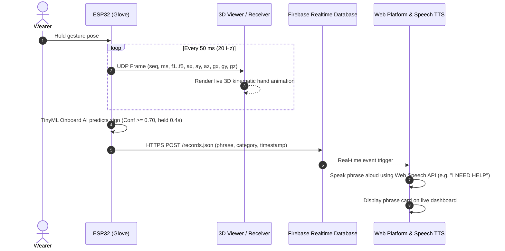

# Sign Language Glove: System Architecture & Diagrams

This document details the complete end-to-end architecture, message sequencing, and state machines for the Sign Language Glove project.

---

## 1. 3-Layer System Architecture

```
┌─────────────────────────────────────────────────────────────────────────────┐
│                       WEARABLE LAYER (ESP32 Glove)                          │
│                                                                             │
│  [5 Flex Sensors] ──┐                                                       │
│                     ├─► [ESP32 DevKit V1] ──► [TinyML Edge AI (60 trees)]  │
│  [MPU6050 6-DOF]  ──┘     (Smooths & Streams 20 Hz, Auto-Tare Baseline)     │
└─────────────────────────────────┬───────────────────────────────────────────┘
                                  │ UDP (Port 4210) & HTTPS
                                  ▼
┌─────────────────────────────────────────────────────────────────────────────┐
│                    RECEIVER & 3D VISUALIZER LAYER                           │
│                                                                             │
│   [UDP Receiver (4210)] ──► [SSE Bridge] ──► [Interactive 3D WebGL Hand]   │
│   (Zero-dependency Python)                     (Real-time joint articulation)│
└─────────────────────────────────┬───────────────────────────────────────────┘
                                  │ Sync recognized phrases & live telemetry
                                  ▼
┌─────────────────────────────────────────────────────────────────────────────┐
│                     CLOUD LAYER (Firebase & Web Platform)                   │
│                                                                             │
│   [Firebase Realtime Database] ──► [Web Speech API (TTS)]                   │
│   (/records.json & /live_telemetry)  (Speaks phrases aloud via phone/laptop)│
│                                           │                                 │
│                                           ▼                                 │
│                                    [Live Web Dashboard]                     │
│                                    (Real-time phrase stream & 3D monitor)   │
└─────────────────────────────────────────────────────────────────────────────┘
```

---

## 2. Sequence Diagram (End-to-End Workflow)



---

## 3. Firmware Control Flowchart

```mermaid
flowchart TD
    A([Power On / Reset]) --> B[Initialize Serial, I2C 400kHz, 12-bit ADC]
    B --> C{MPU6050 found at 0x68?}
    C -- No --> C1[Blink error pattern: 2 short pulses] --> C
    C -- Yes --> T[Auto-Tare resting open-hand baseline]
    T --> D[Connect to Wi-Fi Hotspot 2.4GHz]
    D --> E{Connected?}
    E -- No --> E1[Retry every 8s non-blocking, fast LED blink] --> D
    E -- Yes --> F[Obtain Gateway IP / Target IP, LED steady ON]
    F --> G[Every 10ms: Read 5 ADC with 4x oversampling + IMU, apply EMA filter]
    G --> H{50ms elapsed? (20 Hz)}
    H -- Yes --> AI[Run Onboard Random Forest AI Inference]
    AI --> I[Send UDP frame to port 4210]
    H -- No --> J
    I --> J{Incoming UDP command on port 4211?}
    J -- Yes --> K[Parse TARE command]
    J -- No --> L{Wi-Fi still connected?}
    L -- Yes --> M{2 seconds elapsed?}
    M -- Yes --> N[Upload live telemetry to Firebase /live_telemetry.json]
    M -- No --> G
    N --> G
    L -- No --> G
```
